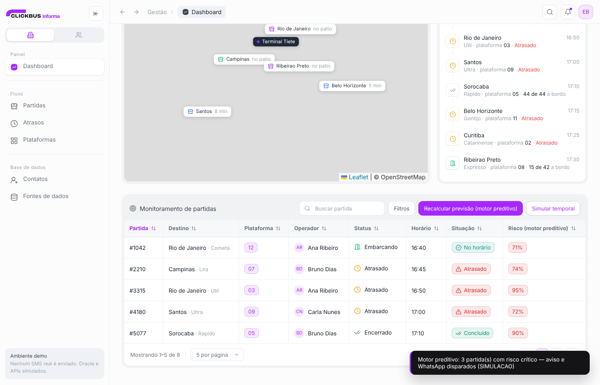

# ClickBus Informa · protótipo

Painel de gestão e operação de terminal rodoviário, unindo o protótipo de alertas por SMS
(Flask + Oracle simulado + APIs públicas) com o painel ClickBus Informa (mapa do terminal,
partidas ao vivo, atribuição de plataformas e aviso instantâneo ao passageiro).

Desenvolvido para o Challenge 2026 · FIAP × ClickBus.



## Equipe

Projeto em grupo:

- Ednaldo Brito
- Fabio Lopes de Morais
- Guilherme Lopes ([@Guara10](https://github.com/Guara10))
- Mariana Leite

**Parte do Guilherme: o motor preditivo de atraso.**
- `services/clima.py`, `services/transito.py`, `services/motor_decisao.py` e `services/whatsapp.py`
- o campo `risco` calculado para cada partida e o endpoint `POST /api/motor/recalcular`
- a coluna "Risco" e os botões do motor no painel

## O que tem

**Gestão**
- Dashboard: KPIs, mapa do terminal (Leaflet) com pinos que expandem, partidas ao vivo e listagem
- Partidas: gráfico por faixa de horário e monitoramento com ordenação, busca e paginação
- Atrasos: partidas atrasadas e distribuição de causas
- Plataformas: **a cena principal**. Troque a plataforma de uma partida e o celular do passageiro recebe o aviso e o SMS na hora
- Contatos: base fictícia do Oracle Azure, com "Testar conexão"
- Fontes de dados: catálogo de APIs públicas do Estado de SP

**Operacional**
- Ao vivo: monitoramento com relógio, mapa e feed
- Disparo de avisos: simulador de SMS com prévia no iPhone e histórico
- Ocorrências: lista com gravidade, estado e resolver/reabrir

**Passageiro**
- `/passageiro`: o app do passageiro em tela cheia. Abra em outra janela (ou outro monitor) durante a apresentação

## Motor preditivo

Cada partida tem um campo `risco` calculado por `services/motor_decisao.py`: uma
**regra explicável** (não é Machine Learning) que combina clima real do destino
(Open-Meteo, sem chave), trânsito (Google Distance Matrix, se `GOOGLE_MAPS_API_KEY`
estiver no `.env` — sem isso, simulado) e o histórico de atraso da viação.

| Fator | Pontos |
|---|---|
| Clima no destino | alta 40 · média 20 · baixa 0 |
| Trânsito (tempo real ÷ tempo livre) | ≥ 1,5x: 45 · ≥ 1,3x: 25 · ≥ 1,15x: 10 |
| Histórico de atraso da viação | 0,5 ponto por ponto percentual |

**Crítico ≥ 60 · Atenção ≥ 35.** Os pesos foram calibrados para que nenhum fator
sozinho dispare alerta crítico, mas dois fatores fortes juntos sim
(ver `tests/test_motor.py`).

Botão **Simular temporal**: cenário de demonstração que força chuva forte nos
destinos e trânsito 30% mais lento, para mostrar o motor escalonando sem depender
do clima do dia. A resposta da API marca `"cenario": "temporal"`.

Botão **Recalcular previsão (motor preditivo)** em Gestão › Dashboard: reconsulta
clima/trânsito de todas as partidas e escalona pra "atrasado" quem ainda está a
caminho e cruzou o limiar crítico, registrando o aviso e disparando WhatsApp.

Endpoint: `POST /api/motor/recalcular` com corpo opcional `{"cenario": "temporal"}`
→ `{ escalonadas, partidas, avisos, cenario }`.

## Segurança do protótipo

- Não conecta ao Oracle.
- Clima (Open-Meteo) e trânsito (Google Distance Matrix) são consultas **reais**
  quando alcançáveis; falham de forma silenciosa para um valor simulado e
  claramente marcado (`"simulado": true`) se não houver rede ou chave — o
  protótipo nunca quebra por causa disso. O mapa usa tiles do OpenStreetMap.
- WhatsApp só é real se as 3 variáveis do Twilio **e** `WHATSAPP_DESTINO_TESTE` estiverem no `.env`,
  e mesmo assim vai **apenas para esse número de teste**, uma mensagem por partida.
  Os contatos da base são fictícios e nunca recebem nada (números inventados podem ser de pessoas reais).
- A troca de plataforma recusa plataformas já ocupadas por outra partida.
- Não envia SMS real.
- Contatos, partidas e ocorrências são fictícios e ficam em memória.

## Executar

```bash
python -m venv .venv
source .venv/bin/activate        # Windows: .venv\Scripts\Activate.ps1
pip install -r requirements.txt
python app.py
```

Acesse `http://127.0.0.1:5000`.

No macOS a porta 5000 costuma estar ocupada pelo AirPlay. Se acontecer, rode:

```bash
python -c "import app; app.app.run(port=5050, debug=True)"
```

## Testes

```bash
pip install pytest
python -m pytest
```

Os testes rodam sem internet e sem credenciais (`MOTOR_OFFLINE=1`) e cobrem as
regras do motor, o cenário de temporal, a troca de plataforma e a proteção do envio de WhatsApp.

## Como demonstrar a cena do pitch

1. Abra `http://127.0.0.1:5000` e vá em **Gestão › Plataformas**.
2. Abra `http://127.0.0.1:5000/passageiro` em outra janela, lado a lado.
3. Clique em uma plataforma livre da partida **Rio de Janeiro · #1042**.
4. O celular muda de plataforma, mostra o aviso e recebe o SMS. O histórico registra "44 avisados".

As telas conversam por `BroadcastChannel` (mesmo navegador). Em produção, isso vira WebSocket ou push.

## API

Endpoints originais (contrato mantido):

| Método | Rota | Descrição |
|---|---|---|
| GET | `/api/status` | Estado simulado de Oracle, APIs e SMS |
| POST | `/api/simular-sms` | `{categoria, cidade, mensagem}` → protocolo de simulação |

Endpoints do terminal:

| Método | Rota | Descrição |
|---|---|---|
| GET | `/api/partidas` | Terminal e partidas |
| POST | `/api/plataforma` | `{partida, plataforma}` → move e registra o aviso |
| GET | `/api/avisos` | Histórico de avisos |

## Estrutura

```
app.py                  Flask: dados simulados, páginas e API
templates/index.html    Painel (todas as abas)
templates/passageiro.html
static/style.css        Design system em CSS puro (tokens, cards, tabelas, chips, mapa, iPhone)
static/js/app.js        Navegação, KPIs, tabelas, plataformas ao vivo, simulador de SMS
static/js/map.js        Mapa Leaflet: pinos, gaveta, filtros
static/js/ui.js         Toast, combobox, sparkline, gráfico de barras, tabela
static/js/live.js       Canal ao vivo entre abas
static/js/icons.js      Ícones inline (lucide)
static/vendor/          leaflet, devices.css (sem CDN, funciona offline)
```

Sem build, sem Node, sem framework de front. Só Flask e arquivos estáticos.

## Alterações depois da entrega do Challenge

Ajustes feitos ao publicar o projeto, depois de revisar a demo:

- **Motor recalibrado.** Com os pesos originais, sem chuva o risco máximo possível era 42%, então o
  botão "Recalcular previsão" quase nunca escalonava nada no dia da apresentação.
- **Cenário "Simular temporal"** para a demo não depender do clima.
- **WhatsApp seguro.** Antes, com o Twilio configurado, o envio ia para os telefones fictícios da base
  (que podem existir de verdade) e para todos os contatos a cada partida.
- **Partida da demo coerente.** A #1042 aparecia indo para "São Paulo" no painel e para o Rio de Janeiro no app.
- **Plataforma ocupada** agora é recusada pela API.
- Nome de pessoa real trocado por nome fictício nos dados de exemplo.
- Testes automatizados e CI.

## Créditos

- Ícones: [lucide](https://lucide.dev) (ISC)
- Mapa: [Leaflet](https://leafletjs.com) + tiles OpenStreetMap
- Moldura do iPhone: [devices.css](https://github.com/picturepan2/devices.css) (MIT)
- Logotipo ClickBus: marca de terceiro, usada como peça de conceito acadêmico

## Evolução posterior

Substituir os dados simulados por `python-oracledb`, usar Azure Key Vault para segredos,
fila de mensagens, consentimento/opt-out, auditoria e gateway SMS homologado.
Trocar o `BroadcastChannel` por WebSocket para o aviso chegar em celular de verdade.
